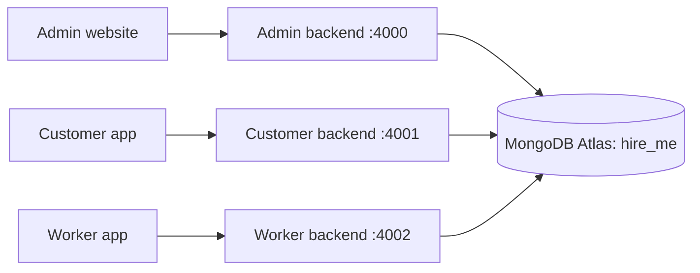

> Historical snapshot. Read [Phase 2 handover](PHASE_2_HANDOVER.md) for current source behavior, tests and next-phase planning.

# Hire Me: updated Phase 1 handover and next-phase planning

Updated: 2026-10-10. Snapshot after Phase 1 authentication, the Expo SDK 57 upgrade,
and clarification of the development OTP flow. This document is self-contained and
contains no actual database credentials, passwords, OTPs, authentication tokens or keys.
Upload this file to the ChatGPT project to plan the next step.

## 1. Current delivery status

Project setup and Phase 1 identity/access are implemented. All three projects have their
own frontend and backend. Customer/worker sign-in, restricted admin provisioning, admin
password plus authenticator verification, persisted sessions and logout are implemented.

Customer and worker use Expo SDK 57. SMS delivery is mocked: no external SMS provider has
been connected. The admin second factor uses an enrolled authenticator, rather than SMS.
Browser and local database flows were verified. Physical Android/iOS execution is still
pending. This is a development build; backend production startup remains blocked.

Profiles, family recipients, consent workflows, worker verification, bookings, dispatch,
payments and service delivery have not been implemented. Existing service cards are static
illustrations. The admin Applications page links to development apps; it is not a worker
application review or customer management feature.

## 2. Product context and authoritative requirements

Working brand: Trusted Assistance. Workspace name: Hire Me. Intended product: a managed,
non-medical family/elderly assistance marketplace, with an intended Delhi NCR pilot.
Illustrative initial services: hospital visit escort, companionship/check-in and station
pickup/drop. Pilot coverage, capacity, brand clearance and commercial assumptions still
need founder decisions; the original blueprint's forecasts/competitor claims are unvalidated.

The founder's requirements override the older setup prompts:

- Exactly three top-level project folders: admin-panel, customer-app and worker-app.
- Each project contains independent frontend and backend npm modules.
- Each of the six modules owns its package.json, package-lock.json, node_modules, source,
  configuration, tests and CI configuration.
- No root package.json/node_modules, pnpm workspace, packages folder or shared runtime imports.
- The three backends are separate services; sharing MongoDB does not combine the backends.
- MongoDB may be shared for now. Preserve the established Atlas database and private settings.
- Original phase prompts are reference material. Do not recreate their old monorepo layout.
- Implement a new phase only after the founder requests it. Live integrations and deployment
  need a separately requested scope.

## 3. Folder structure, technology and connections

```text
Hire Me/
  admin-panel/
    frontend/  Next.js website, independent npm module
    backend/   Admin NestJS API, independent npm module
    docs/      Requirements, architecture, handover and verification records
    AGENTS.md  Project development instructions
    README.md  Project entry documentation
  customer-app/
    frontend/  Expo / React Native customer app, independent npm module
    backend/   Customer NestJS API, independent npm module
    docs/
    AGENTS.md
    README.md
  worker-app/
    frontend/  Expo / React Native worker app, independent npm module
    backend/   Worker NestJS API, independent npm module
    docs/
    AGENTS.md
    README.md
```

Similar contracts/security code is copied into modules deliberately. Keep each copy local
and use contract tests when changing matching frontend/backend behavior. The admin auth:setup
operator script configures three local backend environment files; this is a setup utility,
not a shared runtime dependency.

| Module                | Current technology                               | Development port |
| --------------------- | ------------------------------------------------ | ---------------- |
| admin-panel/frontend  | Next.js 16.4.0, React 19.2.0, TypeScript         | 3000             |
| admin-panel/backend   | NestJS 11.2.7, TypeScript, MongoDB driver 6.21.0 | 4000             |
| customer-app/frontend | Expo 57.0.27, React Native 0.86.3, React 19.2.3  | 8081             |
| customer-app/backend  | NestJS 11.2.7, TypeScript, MongoDB driver 6.21.0 | 4001             |
| worker-app/frontend   | Expo 57.0.27, React Native 0.86.3, React 19.2.3  | 8082             |
| worker-app/backend    | NestJS 11.2.7, TypeScript, MongoDB driver 6.21.0 | 4002             |

Mobile modules also pin SecureStore 57.0.4, Metro runtime 57.0.16, React Native Web 0.21.4,
React types 19.2.18 and TypeScript 6.0.3. Each mobile test compilation uses Node16 module
resolution and TypeScript 6's --ignoreConfig. Use the existing scripts when running checks.

Current verified toolchain: Node 22.18.0, npm 10.9.3 on Windows. Module engines require
Node 22.13.0 or newer. Dependencies and lockfiles stay module-local.



## 4. Built user flows

### Admin panel

```text
Private admin provisioning and authenticator enrollment
  -> phone + password
  -> authenticator code
  -> protected dashboard
  -> session checks / refresh
  -> sign out or return to login after revocation/expiry
```

- Admin accounts are created only through admin-panel/backend's admin:provision command.
  No default runtime administrator or public admin signup was created by this work.
- Passwords use salted scrypt hashes. Authenticator enrollment uses a private TOTP seed.
- Password success creates only an MFA challenge; it does not unlock the dashboard.
- Fresh, non-replayed authenticator verification completes login.
- Next.js checks the session on the server and proxies only to the admin backend.
- Dashboard includes overview, development app links, build roadmap and admin API health.
- Credentials use HttpOnly SameSite Strict cookies; mutations require allowed Origin and CSRF.
- Logout and revoked-session recovery are implemented.
- User/customer management, worker approval and booking operations are future features.

### Customer app

```text
Open app -> international phone number -> request mock OTP
  -> obtain development code in a private backend terminal -> verify code
  -> create/reuse global identity and CUSTOMER membership -> customer home
  -> session refresh / restore -> sign out or sign out all customer devices
```

- First successful verification creates an identity/membership; later logins reuse it.
- Screens include phone input, OTP input, resend countdown, change number, loading/errors,
  masked phone, home, sign-out controls and development connection diagnostics.
- Service cards are illustrative; no booking action/catalog/pricing service is implemented.
- Native refresh credentials use SecureStore. Access credentials stay in memory.
- Browser preview credentials stay in memory; reloading the page requires sign-in again.
- Profiles, addresses, recipients, consent, bookings and payments are pending.

### Worker app

```text
Open app -> international phone number -> request mock OTP
  -> obtain development code in a private backend terminal -> verify code
  -> create/reuse identity and WORKER membership -> worker home: Pending onboarding
  -> session refresh / restore -> sign out or sign out all worker devices
```

- Login and session features mirror the customer flow, with worker-specific permissions/API.
- The same phone can hold CUSTOMER and WORKER memberships; neither grants administrator access.
- Successful worker login enrolls PENDING_ONBOARDING. It does not approve or verify a worker.
- Onboarding forms, document uploads, checks/training, job offers and payouts are pending.

The business flow customer books -> worker accepts -> service is delivered -> payment is
still future work. No cross-project booking or assignment workflow exists yet.

## 5. OTP: actual behavior and how to test

No SMS provider is configured, and requesting an OTP does not send a message to a phone.
The backend generates a random six-digit OTP, persists its keyed digest and challenge
record in MongoDB, and writes an encrypted development delivery message in that backend's
ignored .cache/mock-sms directory. A private operator command decrypts and reveals it once.
Raw OTPs are not returned by HTTP endpoints or ordinary application logs.

Default verification rules: five-minute expiry, five attempts, single use and a 60-second
resend cooldown, with durable phone/IP limits. Verification needs the challenge ID, the
separate challenge credential held in app memory and the submitted code. Successful
verification consumes the challenge and creates a persisted session.

For local development testing:

1. Start the matching backend and frontend. Use an international phone number.
2. Press Send verification code. The development OTP screen shows Mock SMS test challenge
   followed by the actual challenge ID. This ID is not the six-digit OTP.
3. Open a separate private interactive terminal inside customer-app/backend or
   worker-app/backend, matching the app where the request was made.
4. Run the command with the actual ID, then enter the displayed code in the app.

For CMD, run these two lines separately:

```cmd
set /p OTP_CHALLENGE_ID=Paste the challenge ID from the app:
npm.cmd run auth:mock-otp -- %OTP_CHALLENGE_ID%
```

For PowerShell:

```powershell
$otpChallengeId = Read-Host 'Paste the challenge ID from the app'
npm.cmd run auth:mock-otp -- $otpChallengeId
```

The same terminal prints Development test code: followed by the six-digit OTP. The inbox
message is deleted after retrieval; running the command again does not reveal that code.
REPLACE_WITH_CHALLENGE_ID in older examples is a placeholder, not a literal argument.
Request a new challenge after the cooldown if the code expired or was already retrieved.

The current CLI requires AUTH_ENABLED=true, NODE_ENV=development, HOST=127.0.0.1 and an
interactive terminal, plus a current challenge generated by that same backend. Otherwise
it returns Mock code unavailable. Fixed OTPs used by guarded automated fixtures are not
codes for ordinary development login.

Known native testing restriction: phone access uses backend HOST=0.0.0.0 and a LAN API URL,
while the mock inbox CLI checks HOST=127.0.0.1 in its own environment. This configuration
path has not been verified on a physical device. Resolve/document the private CLI setup
when doing native verification; do not assume the LAN instructions alone complete login.
No backend behavior was changed as part of this handover update.

Choosing and connecting live SMS is a separate planning decision. No provider, credentials,
message templates or real delivery integration have been selected/configured.

## 6. Database, ownership and infrastructure

All three runtime backends are configured for MongoDB Atlas database hire_me. MONGODB_URL
holds the private connection string; MONGODB_DB_NAME selects hire_me. The earlier
inventory_db target was replaced for this project, and the inventory database was not
modified by the project's migration. No real connection string is included in this document.

| Collection        | Purpose                                                                        |
| ----------------- | ------------------------------------------------------------------------------ |
| identities        | Global normalized phone identity and account status                            |
| role_memberships  | Independent customer/worker/admin roles and membership status                  |
| otp_challenges    | Verification challenge digests, encrypted challenge phone, attempts and expiry |
| sessions          | Audience-scoped sessions, credential digests, refresh rotation and revocation  |
| auth_limits       | Durable request limits and resend cooldowns                                    |
| admin_credentials | Password hashes and encrypted authenticator seeds                              |
| mfa_challenges    | First-factor challenges and one-time MFA completion                            |
| security_events   | Redacted authentication/revocation events                                      |
| schema_migrations | Applied schema migration versions                                              |

Admin backend owns migration 0001 and all Phase 1 indexes. Applications require its marker
and never create indexes automatically at startup. Enrollment/MFA use replica-set
transactions; unique indexes handle duplicate phones/memberships and concurrent enrollment.
Authentication checks expiry immediately, without waiting for MongoDB TTL cleanup.

Each backend has its own RSA signing key, issuer, key ID and audience. Guards validate the
persisted identity, role and session as well as token claims. Access lasts 15 minutes and
refresh lifetime is 30 days by default. Refresh rotates credentials; detected reuse revokes
the session family. Mobile logout-all affects only the corresponding role/audience.

Private auth keys were generated/preserved in ignored backend .env files. The setup utility
initially shares a digest key and retains separate RSA/encryption keys per backend. Do not
regenerate established keys casually; stored challenges/MFA and existing sessions depend on them.

One Atlas credential is temporarily shared for development. Before deployment, separate
migration/admin/customer/worker database users/grants are needed. Application audience
filters remain mandatory for shared collections; a shared credential is not database-level
isolation. No default runtime accounts or fixture users were seeded into Atlas by this work.
This does not assert that the founder has not subsequently created accounts manually.

Local test infrastructure belongs in admin-panel/backend/compose.yaml:

- MongoDB 8.0 replica set rs0 on loopback port 27018; persistent Docker volume.
- Redis 7.4 on loopback port 6380; persistent Docker volume.
- Transactions and data persistence through container restart were verified.
- Redis is available for later phases; Phase 1 limits currently persist in MongoDB.
- Runtime Atlas use does not require these local containers. Integration/browser suites do.
- Tests create uniquely named local databases and drop them after completion; no Atlas test writes.

Production startup/live integrations remain blocked. Full host reboot and backup restore
have not been verified. Preserve private .env files, database data and established keys.

## 7. API surface and documentation

Customer/worker APIs each expose their own role-scoped routes:

| Method | Path                 | Purpose                                                      |
| ------ | -------------------- | ------------------------------------------------------------ |
| POST   | /v1/auth/otp/request | Request mock OTP and challenge credential; never returns OTP |
| POST   | /v1/auth/otp/verify  | Verify one-time code and enroll/login                        |
| POST   | /v1/auth/refresh     | Rotate session credentials                                   |
| GET    | /v1/auth/me          | Read current authenticated user                              |
| POST   | /v1/auth/logout      | Revoke current session                                       |
| POST   | /v1/auth/logout-all  | Revoke all sessions for that role/audience                   |

Admin routes are /v1/admin/auth/login, /mfa/verify, /refresh, /logout and /me under the same
/v1/admin/auth prefix. Password login returns a challenge only; MFA completion sets cookies.
There is no public admin registration route. For exact request/response/status schemas,
read IDENTITY_API.md and each backend/docs/openapi.json.

All three APIs retain /v1/health and Swagger /docs. Swagger documents Phase 1 version 0.2.0.
The health payload deliberately retains phase 0/version 0.1.0 for compatibility; it means
process liveness, not successful database/auth readiness or the implemented product phase.

Input/errors include request IDs. HTTP 400/401/403/429/503 cover invalid input,
authentication/authorization, throttling and unavailable auth/database/schema. Responses
never reveal OTPs or administrator account existence. Logging excludes credentials and
sensitive request contents. OpenAPI is regenerated after backend contract changes.

## 8. Install, start and test

On the current machine dependencies, private authentication settings and migration 0001
were prepared during implementation. The following setup commands are for a fresh install
or deliberate operator setup; preserve existing .env files and keys.

Inside EACH of the six modules, for a fresh installation:

```powershell
npm.cmd ci --ignore-scripts
if (!(Test-Path .env)) { Copy-Item .env.example .env }
```

Configure private backend database/auth settings and frontend API addresses as described
in .env.example. Then, when setup is needed, inside admin-panel/backend:

```powershell
npm.cmd run auth:setup
npm.cmd run db:migrate
npm.cmd run admin:provision
```

Provisioning requires a private interactive terminal. Choose the admin phone/password and
enroll the displayed private authenticator URI. No default login credentials are supplied.

Start modules in separate terminals, each opened inside the listed directory:

| Directory             | Command         | Address               |
| --------------------- | --------------- | --------------------- |
| admin-panel/backend   | npm.cmd run dev | http://127.0.0.1:4000 |
| admin-panel/frontend  | npm.cmd run dev | http://localhost:3000 |
| customer-app/backend  | npm.cmd run dev | http://127.0.0.1:4001 |
| customer-app/frontend | npm.cmd run web | http://localhost:8081 |
| worker-app/backend    | npm.cmd run dev | http://127.0.0.1:4002 |
| worker-app/frontend   | npm.cmd run web | http://localhost:8082 |

For Expo Go, stop the old Expo server with Ctrl+C and run in each mobile frontend:

```powershell
npm.cmd run dev -- --clear
```

Use Expo Go compatible with SDK 57 and scan the newly generated QR code. Customer uses
port 8081; worker uses 8082. Metro cache clearing prevents stale bundles after the SDK upgrade.
A phone's 127.0.0.1 is the phone itself. Physical access requires the computer's LAN API
address and a reachable backend; Android emulator may use 10.0.2.2. Frontend env variables
are EXPO_PUBLIC_API_URL, containing only the API URL. See the native OTP restriction above
and DEVICE_VERIFICATION.md. iOS native tooling/build execution requires macOS.

For local test services, inside admin-panel/backend:

```powershell
npm.cmd run services:up
```

Every module has check and format:check. Backends also have test:integration and openapi;
frontends have test:ui. Build the matching backend before its frontend UI suite.

```powershell
npm.cmd run check
npm.cmd run format:check
```

Integration/UI suites require the local replica set. Browser checks need Chrome/Edge or
Playwright Chromium. infra:check intentionally restarts this project's containers and
checks persistence, so run it only when no ongoing task depends on those containers.
Detailed troubleshooting, configuration defaults and isolated test ports are in
PHASE_1_RUNBOOK.md. Do not use destructive volume removal to reset development casually.

## 9. Verification evidence and limits

These are recorded results from implementation and the SDK upgrade, not a claim that all
checks were rerun during this documentation-only update. ACCEPTANCE.md holds the evidence.

| Verification                                      | Recorded result                                                                                         |
| ------------------------------------------------- | ------------------------------------------------------------------------------------------------------- |
| Independent layout/dependencies                   | Six module-local installs; exactly three top-level projects                                             |
| Phase 1 lint/types/tests/builds                   | Passed across all six modules                                                                           |
| Phase 1 unit/HTTP/client tests                    | 57 passed: 14 per backend and five per frontend                                                         |
| Phase 1 real MongoDB integration                  | 27 passed: nine per backend                                                                             |
| Phase 1 browser suites                            | All three passed login/errors, logout and revoked-session recovery; admin MFA/cookies/CSRF also checked |
| Atlas connection/schema                           | Ping passed; migration 0001 applied to hire_me without seeding runtime users                            |
| Local infrastructure                              | Replica-set transaction and persistent Mongo/Redis markers survived container restart                   |
| SDK 57 dependency checks                          | Both mobile expo install --check runs passed                                                            |
| SDK 57 Expo Doctor                                | Both passed 21/21 checks with expo-doctor 1.20.4                                                        |
| SDK 57 mobile checks                              | Both lint/types/tests/web exports and formatting passed; ten frontend tests rerun                       |
| SDK 57 browser suites                             | Both mobile login/error/resend/logout/revocation suites passed against disposable local Mongo fixtures  |
| SDK 57 native JavaScript                          | Android/iOS Hermes exports passed for each app; all four development manifests reported SDK 57.0.0      |
| Native Android/iOS device runtime                 | NOT RUN; no Android device was attached during upgrade verification                                     |
| Native APK/IPA build/install                      | NOT RUN; exported JavaScript is not a native application binary                                         |
| Full host reboot / backup restore                 | NOT RUN                                                                                                 |
| External security review / remote CI / deployment | NOT RUN                                                                                                 |

The 57 plus 27 tests are 84 Phase 1 tests; SDK upgrade reruns are not additional distinct
Phase 1 tests. Negative browser cases intentionally produce invalid-input/auth responses
and aborted network requests. Test servers were stopped and fixture databases removed.
Native SecureStore/relaunch/background/device-lock behavior is implemented but unverified
on devices. Module CI workflows are prepared; they apply when a module is its repository
root. This workspace has no configured Git repository/remote CI execution.

## 10. Completed work history

1. Read the original startup blueprint/phase prompts and created the initial foundation.
2. Removed the temporary empty index.html; applications have their own entry points.
3. Restructured into admin-panel, customer-app and worker-app at the founder's request.
4. Split frontend/backend dependencies and configurations into six independent npm modules;
   removed the root workspace/shared packages and kept project docs inside the projects.
5. Established separate API ports, local contracts, validation, health/request IDs, mocks,
   Swagger, tests, formatting/lint settings, CI configuration and startup documentation.
6. Configured all runtime backends for Atlas database hire_me and preserved private credentials.
7. Verified local Mongo/Redis infrastructure; applied admin-owned identity migration 0001.
8. Implemented Phase 1 mobile identity/OTP/session flows and restricted admin password/MFA.
9. Verified unit/HTTP/client, real Mongo integration and browser flows; recorded remaining limits.
10. Upgraded both mobile apps incrementally from SDK 55 through 56 to SDK 57 to match Expo Go;
    aligned dependency pins/lockfiles, updated TypeScript test compilation and verified bundles.
11. Explained all three app flows and clarified that OTP retrieval is a private development
    terminal workflow with no real SMS service. Added copyable CMD/PowerShell instructions.
12. Expanded this handover and synchronized current documentation across the three projects.

Historical ADR 0001 and PROJECT_HANDOVER.md describe the old foundation. Current authority
is AGENTS.md, ARCHITECTURE.md, ADR 0003/0004 and this updated handover.

## 11. Next-step planning boundary

The previously proposed Phase 2 is customer profiles, family recipients, explicit consent,
emergency contacts, encrypted sensitive notes, address GeoJSON and scoped care-circle
invitations. It is proposed scope, not implemented functionality or current authorization
for coding. The founder now wants to use this handover to decide the next plan.

Before implementing that phase:

- Decide profile/address fields and recipient relationship/ownership rules.
- Decide how an adult recipient gives consent, how it is recorded and withdrawn, and what
  happens when a recipient cannot independently consent. Verified phone ownership alone
  does not establish recipient consent.
- Define care-circle invitation permissions, expiry, acceptance, revocation and replay rules.
- Decide collection ownership and admin-owned migration 0002 without changing identity/session data.
- Define encryption/key handling, audit redaction and retention/deletion for sensitive notes.
- Design customer screens and authenticated APIs, including loading, empty and error states.
- Specify forbidden access, withdrawn consent, concurrent edits/invites and migration checks
  against isolated real MongoDB. Preserve admin MFA for privileged operations.
- Keep worker onboarding pending; verification, jobs, dispatch and payment are later phases.

Phase 1 follow-up decisions can be scheduled explicitly: finish physical-device testing,
resolve the private mock CLI/LAN configuration path, and decide whether live SMS should be
added before Phase 2. No SMS provider is selected. Adding SMS needs a separate delivery,
configuration, failure/retry and test plan. Do not silently introduce a provider or deployment.

Later planned areas: service catalog/quotes, booking states/history, worker verification
and eligibility, dispatch, payment ledger/refunds/payouts, delivery checkpoints, support,
privacy workflows and release hardening. The dashboard roadmap does not mean these exist.

## 12. Prompt to paste into the next planning chat

> This is the current Hire Me / Trusted Assistance handover. Read it as an implementation
> snapshot. Phase 0 foundation and Phase 1 identity/access are built; both mobile apps use
> Expo SDK 57. SMS is mocked, and physical-device testing is still pending. Preserve the
> three projects and six independent frontend/backend modules, their separate APIs, Atlas
> database hire_me and existing authentication. Do not recreate a root workspace/shared
> package or assume that dashboard/service previews are working business features. Help me
> decide the next phase. Start with the unresolved Phase 1 device/OTP delivery decisions and
> the proposed Phase 2 profiles, recipients, consent, emergency contacts and care-circle
> scope. Ask only the product questions necessary to choose scope, then produce a concrete
> plan with project-by-project screens/APIs, data ownership, migration 0002, permissions,
> failure states, tests and acceptance criteria. Planning does not authorize live SMS,
> worker approval, bookings, payments or deployment; identify those as separate decisions.

## 13. Supporting documents

This file contains the overview needed for planning. For deeper review, upload/read these
current files from the same docs directory:

- PRD.md: product scope and future boundaries.
- ARCHITECTURE.md: independent modules and runtime ownership.
- IDENTITY_API.md: implemented authentication contracts and failure behavior.
- SECURITY.md: current controls and development limitations.
- ACCEPTANCE.md: actual verification records and untested items.
- PHASE_1_RUNBOOK.md: detailed setup/start/test commands.
- DEVICE_VERIFICATION.md: native checklist, still unexecuted.
- adr/0003-independent-modules.md and adr/0004-identity-ownership.md: architecture decisions.
- CHANGELOG.md: Phase 1 and SDK upgrade change record.

Each backend/docs/openapi.json supplies that API's generated schema. Never upload private
.env files, mock inbox files, live challenge/session credentials or authenticator seeds.
